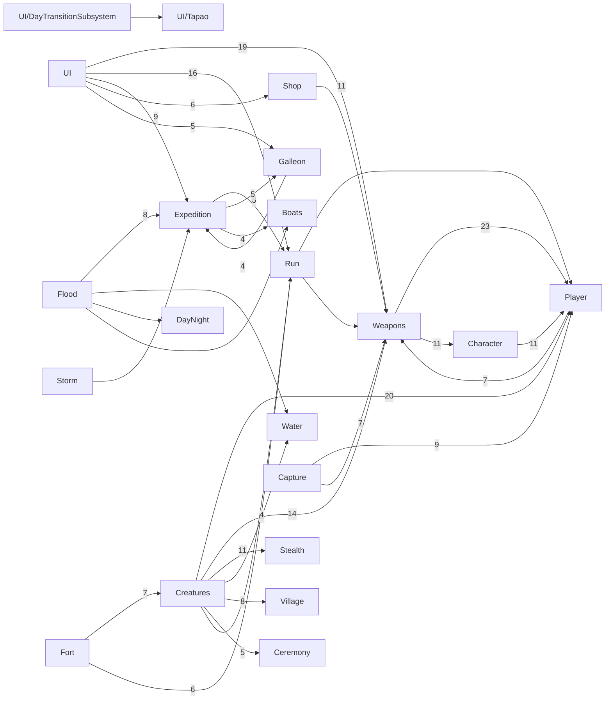

# 01 — Carte du dépôt Tapao Rush Island (faits observés)

- **Date** : 2026-10-23 · **Branche lue** : `ccr-9def995a-0ashaf` (HEAD `45437d7`).
- **Méthode** : lecture seule du code, des scripts, de la configuration et de la documentation. Rien n'a été compilé, lancé ni mesuré.
- **Limite majeure** : dans ce clone, les `.uasset` et `.umap` sont des **pointeurs Git LFS** (vérifié sur `monke_island/Content/MonkeIsland/Maps/Lvl_Raraka.umap` : `version https://git-lfs.github.com/spec/v1`, `size 110061486`). Le contenu des Blueprints, des graphes PCG, des matériaux et des DataAssets n'a donc pas pu être ouvert. Tout ce qui les concerne vient de la documentation et est signalé comme tel.
- **Notation** : `S/` = `monke_island/Source/monke_island/`. Les chemins sont relatifs à la racine du dépôt.
- Ce document est **factuel**. Les opinions et recommandations sont dans `02_ARCHITECTURE_PROPOSAL.md`.

> **Écart de cadrage à noter d'emblée.** La mission décrit « un jeu de survie sur un atoll face aux catastrophes naturelles (cyclone, submersion) ». Le dépôt décrit autre chose : un **jeu coopératif d'extraction maritime** (1 à 4 joueurs), où une Couronne satirique envoie des équipages piller des îles « avant que la mer ne les reprenne » (`README.md`, section « Le jeu » ; `docs/CAHIER_DES_CHARGES.md` §1). La submersion y est un **compte à rebours de fin de manche**, pas l'objet du jeu. Il n'y a pas de cyclone en tant que tel : il y a un vent de tempête et une « tempête finale » (§3).

---

## 1. Socle technique

### 1.1 Moteur, module, plugins
| Élément | Fait | Source |
|---|---|---|
| Version d'UE | 5.8 (5.8.3 selon le README). Le `.uproject` ne contient qu'un GUID d'association moteur (`EngineAssociation {9B825377-…}`), pas de numéro de version | `monke_island/monke_island.uproject:3`, `README.md` (« Développer ») |
| Modules C++ | **Un seul** module runtime, `monke_island` | `monke_island.uproject:6-15` |
| Dépendances publiques | Core, CoreUObject, Engine, InputCore, EnhancedInput, AIModule, StateTreeModule, GameplayStateTreeModule, UMG, Slate, SlateCore, ProceduralMeshComponent | `S/monke_island.Build.cs:11-24` |
| Dépendances privées | MoviePlayer, PhysicsCore, Niagara, CoreOnline, OnlineSubsystem, OnlineSubsystemUtils ; UnrealEd et Json en éditeur seulement | `S/monke_island.Build.cs:27-43` |
| Plugins runtime | Niagara, StateTree, GameplayStateTree, ProceduralMeshComponent, OnlineSubsystem, OnlineSubsystemNull, OnlineSubsystemUtils | `monke_island.uproject:17-130` |
| Plugins éditeur | ModelingToolsEditorMode, ModelContextProtocol (MCP) et 12 « Toolsets » MCP, dont **PCGToolset** | `monke_island.uproject` |
| Plugin **PCG** lui-même | Non listé explicitement dans le `.uproject` (activé par défaut ou par dépendance du toolset : non vérifiable ici) | `monke_island.uproject` |
| Plugin **Water** | Non activé | `monke_island.uproject` |
| Volume de code | 335 `.cpp`, 332 `.h`, ≈ 144 000 lignes, 233 `UCLASS` | comptage `find`/`wc` sur `S/` |

### 1.2 Répartition C++ / Blueprints
- **C++** : 45 dossiers de domaine sous `S/`. Les plus gros (nombre de `.h`) : `Weapons/` 47, `Creatures/` 45, `UI/Tapao/` 17, `Capture/` 12, `Fort/` 12, `Run/` 11, `Village/` 11, `Boats/` 10, `Storm/` 8, `Flood/` 7, `Expedition/Core/` 7, `Expedition/Islands/` 7.
- **Code du template** encore présent : `S/Variant_Horror/`, `S/Variant_Shooter/` (36 fichiers), toujours inclus par `S/monke_island.Build.cs:45-53`.
- **Blueprints** (`Content/MonkeIsland/`) : 98 `BP_*`, dont surtout des objets et armes (`BP_Ammo_*`, `BP_Loot_*`, `BP_Artifact_*`, `BP_Musket`…), des PNJ (`BP_BeanFR_*`, `BP_GiantCrab`), et le framework : `BP_IslandGameMode`, `BP_BootGameMode`, `BP_ExpeditionGameState`, `BP_Islander`, `BP_IslanderBean`, `BP_Barque`.
- **Données** : 163 `DA_*`, 57 `DT_*`, 7 graphes `PCG_Raraka_*`, ≈ 669 matériaux et instances (`M_*`, `MI_*`).
- **Nature des Blueprints** (d'après la documentation, contenu non lisible) : des enfants de classes C++ réglés par données. `BP_BootGameMode` hérite d'`AExpeditionBootGameMode` (`docs/features/fragments-tuamotu.md:346,386`) ; `BP_IslandGameMode` utilise `BP_Islander` et le contrôleur du template (`docs/features/player-islander.md:41`). Aucun `BlueprintImplementableEvent` ni `BlueprintNativeEvent` n'a été trouvé dans `Flood/`, `Storm/`, `Hazards/`, `Water/`, `DayNight/`, `Foliage/`, `Ambience/` et `Expedition/Core/`. **Logique dans les Level Blueprints : non vérifiable** (assets LFS).

### 1.3 Systèmes UE utilisés
| Système | Utilisé ? | Preuve |
|---|---|---|
| Landscape | **Non**. Terrain en static meshes Nanite (51 tuiles `SM_Raraka_Terrain_x_y`) | `grep ALandscape` = 0 ; `docs/reference/map/raraka/README.md:136` |
| World Partition | **Non** (aucun réglage dans `Config/*.ini`, décision reportée à T-091) | `docs/features/fragments-tuamotu.md:311`, `docs/production/board.md:22,98` |
| PCG | **Oui, en éditeur** : 7 graphes qui lisent des DataTables produites par Python | `Content/MonkeIsland/Environment/PCG/`, `docs/reference/map/raraka/README.md:140-164` |
| Water (plugin) | **Non**. Plan statique `SM_Raraka_Water` à Z=0, surface de vagues Gerstner en `UProceduralMeshComponent`, sous-système maison `UIslandWaterSubsystem` | `README.md` raraka:137, `S/Water/WaveSurfaceActor.h:53`, `S/Water/IslandWaterSubsystem.h:23` |
| Niagara | Oui (24 fichiers C++ : sang, pluie `NS_Rain`, feuilles…) | `S/monke_island.Build.cs:30` |
| Chaos | Physique rigide standard (substepping 1/120 s). Pas de Geometry Collection ni de destruction | `monke_island/Config/DefaultEngine.ini:120-124` ; `grep GeometryCollection` = 0 |
| GAS | **Non** (`UAbilitySystem` = 0) | grep |
| Mass | **Non** (`MassEntity` = 0) | grep |
| Enhanced Input | Oui (28 fichiers) | `S/monke_island.Build.cs:16` |
| SaveGame | Oui (`URunSaveGame`, écriture par `SaveSlotFile`) | `S/Run/RunSaveGame.h:50-66`, `S/Run/SaveSlotFile.h` |
| StateTree | Seulement dans le code du template (`Variant_Shooter/AI`) ; aucun PNJ du jeu ne l'utilise | rapport d'exploration, `S/Creatures/TikiCreature.h:322-324` |
| Compute shaders / RDG / Render Targets | **Non** (0 occurrence) | grep |
| Rendu | Lumen (GI et réflexions), VSM, ray tracing, Substrate, DX12 SM6 | `DefaultEngine.ini:22-48` |

---

## 2. Boucle de jeu

### 2.1 Classes du framework
| Rôle | Classe | Source |
|---|---|---|
| GameMode de base | `Amonke_islandGameMode : AGameModeBase` (abstrait ; contrôle d'accès, `ProcessServerTravel`) | `S/monke_islandGameMode.h:26`, `.cpp:125-131` |
| GameMode de lancement | `AExpeditionBootGameMode` (sans pion, choisit l'île) | `S/Expedition/Islands/ExpeditionBootGameMode.h:23` |
| GameMode de test | `AMonkeTestGameMode` | `S/TestMap/MonkeTestGameMode.h:17` |
| GameState | `AExpeditionGameState : AGameStateBase`, **seul GameState C++** | `S/Expedition/Core/ExpeditionGameState.h:42` |
| PlayerController | `Amonke_islandPlayerController` (plus ceux du template) | `S/monke_islandPlayerController.h:20` |
| PlayerState | **Non trouvé** (aucune classe C++) | `docs/audit/2026-10-04-commercial/31-architecture.md:21` |
| Personnage joueur | `AIslanderCharacter : ACharacter` + `UIslanderMovementComponent` | `S/Player/IslanderCharacter.h:67` |
| GameMode global par défaut | celui du **template** (`BP_FirstPersonGameMode`) ; `GameInstance` du moteur | `DefaultEngine.ini:14,17` |
| Map de démarrage | `L_MainMenu` ; maps : `L_Boot`, `Lvl_Raraka`, `Fragments/L_Frag_Raraka_01`, `LI_ExpeditionCore`, `LI_FortFrench(_Land)`, `Test/L_Test_Flat` | `DefaultEngine.ini:15`, `Content/MonkeIsland/Maps/` |

### 2.2 Déroulé d'une partie
1. **Menu** : `UTapaoUISubsystem::TravelToPlay` ouvre la map de jeu (`S/UI/Tapao/TapaoUISubsystem.cpp:1125`).
2. **L_Boot** : `AExpeditionBootGameMode` tire une île (seed fixe, sinon `FDateTime::UtcNow()`), puis `UExpeditionIslandSubsystem::TravelToMapURL` fait **le seul `ServerTravel`** du code (`S/Expedition/Islands/ExpeditionBootGameMode.cpp:86-87,145` ; `ExpeditionIslandSubsystem.cpp:633-675`).
3. **Île** : le galion n'a pas de map propre. C'est un acteur (`AGalleonActor`) posé au large de l'île. Au `BeginPlay` serveur, `AExpeditionGameState` appelle `URunSubsystem::BeginDay` puis `StartExpedition` ; le délai du déluge est multiplié par la difficulté du jour (`ExpeditionGameState.cpp:117,181,197-201`).
4. **Phases** : `EExpeditionPhase` = `Preparing → Exploring → Submerging → Resolved` (`S/Expedition/Core/ExpeditionTypes.h:10-20`). Transitions dans `RefreshPhase` (sur timer) et `SetPhase` (`ExpeditionGameState.cpp:394,434`).
5. **Pacification** : `AFlagCeremonySite` appelle `AddZoneBonus`, qui repousse l'échéance du déluge (`S/Ceremony/FlagCeremonySite.cpp:267` → `ExpeditionGameState.cpp:310-334` → `ExpeditionClock.cpp:36`).
6. **Départ** : vote et préavis à la barre (`S/Galleon/GalleonDeparture.h:12,24`, `GalleonDepartureComponent.cpp:440`), ou fin du déluge. `ResolveDelugeEnd` tue tout joueur hors du galion (`ApplyHealthDamage(1.0e6f, …, EDeathCause::Flood)`, `ExpeditionGameState.cpp:612-651`, ligne 648).
7. **Bilan** : `EndDay` additionne la valeur de la cargaison des galions et appelle le calcul pur `FRunContractCalculator::EndDay` (`ExpeditionGameState.cpp:654-672,810` ; `S/Run/RunContract.cpp:63`).
8. **Issues** (`ERunDayVerdict`, `S/Run/RunContract.h:49`) : `NextDay`, `QuotaMetChoose` (rester un jour de plus), `ContractComplete`, `ContractFailed`, `Victory`, `Executed`.
   - **Victoire** : dernier contrat honoré (`RunContract.cpp:145-157`).
   - **Défaite** : quota manqué au dernier jour d'un contrat avec `bExecuteOnFailedContract` : exécution de l'équipage (`RunContract.cpp:101-107`, `S/Run/RunRules.h:96-100`, `ExpeditionGameState.cpp:712`).
   - **Équipage anéanti** : le jour est perdu, la partie continue (`ExpeditionGameState.cpp:562-604`).
9. **Jour suivant** : sauvegarde du run puis retour au boot (`RestartFromBoot`, `ExpeditionGameState.cpp:820`).
- **Campagne** : 10 jours, contrats de 3 jours, quotas 5 500 / 10 500 / 20 500 (`S/Run/RunRules.h:29-33,62`), déblocages par jour (`S/Run/RunCampaign.h:10`). `URunSubsystem` est un `UGameInstanceSubsystem` (`S/Run/RunSubsystem.h:37`).
- **Code orphelin probable** : `FRunCalculator` (manches de l'ADR-005), utilisé seulement par les tests (`S/Run/RunCalculator.cpp:40,114`).

### 2.3 Ressources, inventaire, construction, PNJ
- **Inventaire** : `UIslanderInventoryComponent`, `AInventoryItemActor`, `UInventoryItemDefinition`, rangés dans `Weapons/` et non dans `Items/` (`S/Weapons/IslanderInventoryComponent.h:67`).
- **Valeur des objets** : `UValuableComponent` (`S/Items/ValuableComponent.h:19`) ; économie pure dans `S/Economy/` ; argent via `URunSubsystem::TrySpend` / `AddMoney` (`RunSubsystem.cpp:441,463`), appelés par la boutique, la capture (rançon) et la cérémonie.
- **Construction** : **non trouvée**.
- **PNJ** : villageois et guerriers « tiki » (`ATikiCreature`, déplacement serveur maison sans NavMesh, `S/Creatures/TikiCreature.h:322-324`), soldats français (`AFortSoldier`, NavMesh si présente, `S/Fort/FortSoldier.cpp:885-894`), crabe géant (`AGiantCrab`), requin (`ASharkActor : APawn`, cinématique). Orchestration : `ATikiDirector`, `UHostilitySubsystem`.

---

## 3. Catastrophes (aléas)

### 3.1 Inventaire
| Aléa | Déclenchement | Simulation | Lien au terrain | Source |
|---|---|---|---|---|
| **Submersion** | **Horloge** : échéance = départ + `InitialFloodDelay` + 120 s par zone pacifiée. Défaut C++ 120 s (le DataAsset vaut 540 s selon la doc) | Eaux peu profondes « virtual pipes » (Mei, Decaudin, Hu 2007) sur grille **CPU** (`ParallelFor`) | Le sol est lu par **lancers de rayons** au chargement ; il guide l'écoulement mais **ne décide pas** du déclenchement | `S/Expedition/Core/ExpeditionClock.cpp:22-25`, `ExpeditionRules.h:25-33`, `S/Flood/FloodGrid.h:4-10`, `FloodGrid.cpp:46-87`, `FloodSimulationActor.cpp:466-521` |
| **Montée finale** | 650 cm sur 60 s, exposant 1,6, puis +10 cm/s jusqu'à +15 m ; ne redescend jamais | Fonction pure du temps serveur | Aucun | `ExpeditionClock.cpp:101-116`, `ExpeditionRules.h:47-63`, `S/Flood/FloodSchedule.cpp:44-47` |
| **Vent de tempête** | Rafales planifiées par `FRandomStream(Seed + 7919·k)`, `Seed` = 1337 ; vent violent au début de la submersion | Fonction pure du temps + bruit de Perlin (constantes codées en dur) | Aucun. L'abri est détecté par **mots-clés dans le nom des meshes** (`Minka`, `House`, `Pandanus`…) | `S/Storm/WindMath.h:25-29,95-112`, `WindRules.h:44-88,120-124`, `WindStormActor.cpp:86-95,151-190` |
| **Bascule météo** | **Scriptée** : un joueur saisit un artefact de temple | Transition `SmoothStep` 10 s ; pluie Niagara locale | Aucun | `S/Storm/WeatherDirector.cpp:68-71,194-254`, `WeatherMath.h:16-26` |
| **Chute de noix de coco** | Aléatoire **non seedé** (`FMath::FRandRange`, `FRand`), fréquence liée au vent | Acteur physique répliqué ; KO au-delà de 750 cm/s | Palmiers trouvés par **nom de mesh** et hauteur ≥ 6 m | `S/Hazards/CoconutFallDirector.cpp:20,42-73,99-107`, `FallingCoconutActor.cpp:87-105` |
| Vagues | Somme de Gerstner sur le temps serveur (ambiance) | Mesh procédural 769×769 qui suit la caméra | Aucun | `S/Water/WaveMath.h:9-79`, `WaveSurfaceActor.cpp:21-23` |
| Jour/nuit | Heure de départ tirée sans seed par le serveur, puis répliquée | Courbe de clés `DA_DayNightRules` | Aucun | `S/DayNight/DayNightCycleActor.cpp:89` |

### 3.2 Simulation de la submersion (détail)
- **Grille d'expédition** : 320 × 320 cellules de 8 m, soit 2,56 km de côté, centrée par le serveur devant la barque d'arrivée (`S/Flood/FloodRules.h:56-71`, `FloodSimulationActor.cpp:171-203`). Repli hors expédition : 512 × 512 cellules de 6 m (`FloodRules.h:119-124`).
- **Pas fixe** de 0,05 s, au plus 4 pas par image. Le nombre de pas est calculé depuis l'horloge, pas depuis le `DeltaTime` (`FloodRules.h:144-160`, `FloodSimulationActor.cpp:549-558`).
- **Sol** : `LineTraceSingleByObjectType` vertical sur `ECC_WorldStatic`, 16 000 rayons par image, en ignorant la végétation instanciée (`FloodSimulationActor.cpp:500`, `FloodRules.h:132-140`). Pas de heightmap précalculée.
- **Rendu** : un `UProceduralMeshComponent` par bloc de 32 × 32 cellules, reconstruit toutes les 0,2 s avec un budget de 1 ms ; une « jupe » mise à l'échelle couvre l'extérieur (`FloodSimulationActor.cpp:237-361`, `FloodRules.h:86-108,168-176`).
- **Réseau** : seul le centre de grille est répliqué. Chaque machine simule localement à partir de l'horloge répliquée ; le serveur fait foi pour le gameplay (`FloodSimulationActor.cpp:163-169,401-424`, `docs/features/storm-flood.md:114`).
- **Effets** : la surface simulée alimente `UIslandWaterSubsystem` (patauger, nager, se noyer : 3 s de grâce, 12 dégâts/s) (`FloodSimulationActor.cpp:255-263`, `S/Player/IslanderMovementComponent.h:125,129`). Le requin nage sur les terres submergées (`docs/features/shark.md`).

### 3.3 Persistance
- **Aucune**. Le terrain n'est jamais déformé (`FloodRules.h:15-16`). `URunSaveGame` ne sauve que la version, le contrat, le dernier bilan, les équipements et la date (`S/Run/RunSaveGame.h:50-66`). Chaque jour recharge une map neuve (`ExpeditionRules.h:88-91`).

### 3.4 Déterminisme
- 245 lignes de `S/` (hors tests) utilisent le hasard. Les aléas « eau, vent, vagues, météo » sont des fonctions du temps serveur répliqué : ils sont déterministes.
- Graines non maîtrisées : `FMath::Rand()` quand la seed vaut 0 (camps, butin, villages, forts : `S/Camps/CampSpawner.cpp:131`, `S/Items/LootScatterSpawner.cpp:129`, `S/Village/VillageSpawner.cpp:231`, `S/Fort/FortSiteSubsystem.cpp:166`) ; `FPlatformTime::Cycles()` pour l'arrivée de la barque (`S/Boats/BoatStartSubsystem.cpp:216-219`) ; `UtcNow` pour le choix de l'île (`ExpeditionBootGameMode.cpp:86`). Il n'existe **pas de seed unique d'expédition** dont tout dériverait.

---

## 4. Monde et maps

- **Production** : données réelles traitées par Python, **pas de travail à la main sur le relief** (`scripts/map/build_terrain.py:13-17`).
  - Trait de côte officiel (terre) et raster de l'atlas des récifs IRD (platier, pentes, lagon, passes).
  - **Hauteurs inventées** : profils constants codés en dur, terre de +0,5 à +3,7 m, lagon de −8 à −30 m, océan à −300 m, pente du rivage ≤ 7° (`build_terrain.py:46-59`).
  - **Aucune bathymétrie mesurée**, ni DEM, LiDAR, Copernicus ou GEBCO (`docs/reference/map/raraka/README.md:25` ; `build_terrain.py:368` : « à remplacer si relevé SHOM/IRD »).
  - Hauts-fonds et masque de végétation calculés sur la **luminance de l'imagerie satellite** (`build_terrain.py:15,238-284`).
- **Sources** : Te Fenua (ArcGIS FeatureServer en GeoJSON : parcelles, rivage, cocoteraies DAG, bâti, occupation du sol, toponymes) et WMTS (imagerie `IMAGE_PUBLIQUE` © Maxar, `std_atlasrecif`) (`scripts/map/fetch_tefenua.py:12-21`, `fetch_imagery.py:4-26`). OSM : mentionné dans le skill `map-geodata` uniquement, aucun script.
- **Outils** : Python avec numpy, Pillow, scipy ; Web Mercator codé à la main (`build_terrain.py:25-27,67-72`). **GDAL, rasterio, shapely, pyproj : non trouvés.** Blender (`bpy`) pour la végétation procédurale (`scripts/atoll/`). Pas de QGIS ni de Houdini.
- **Taille et résolution** : atoll de Raraka, 29 × 26 km, 352 motu (`docs/adr/ADR-004-fragments-tuamotu.md:7`). Mosaïque z15 de 6400 × 5632 px à **4,59 m/px** (`README.md` raraka:6).
- **Sorties** : tuiles OBJ → static meshes Nanite (51 pour l'atoll, collision complexe) ; masques RGBA 4096² ; `heightmap_16.png` « pour référence » (`build_terrain.py:300-302`).
- **Maps** : `Lvl_Raraka` (atoll entier, 110 Mo, map source) et **un seul fragment jouable** construit, `L_Frag_Raraka_01` (14 tuiles, 1,63 M triangles, 36,8 k instances) sur 20 fragments catalogués (`docs/features/fragments-tuamotu.md:421,449` ; `docs/reference/map/raraka/README.md:119`). 21 `DA_Island_Raraka_*` existent pour 20 fragments.
- **Végétation** : Python → DataTables (`DT_Raraka_Palms`, 43 057 lignes ; 40 blocs `DT_Raraka_{Hard,Soft}_NN`) → graphes PCG (`README.md` raraka:46,100,140-164).

---

## 5. Données et configuration
- **58 classes C++** dérivées de `UDataAsset` / `UPrimaryDataAsset`, surtout des `U*Rules` (`FloodRules`, `WindRules`, `WeatherRules`, `ExpeditionRules`, `RunRules`…), plus `UExpeditionIslandDefinition`, `UIslandCatalog`, `UShopCatalog`. **163 `DA_*`** dans `Content/`.
- **DataTables** : 57 `DT_*` en `GameplayTagTableRow` détourné (le tag porte le chemin du mesh, le commentaire porte la transformation) (`scripts/map/place_vegetation.py:12-13,49`). Une seule `FTableRowBase` C++, celle du template (`S/Variant_Shooter/Weapons/ShooterPickup.h:19`).
- **`.ini`** : maps et modes (`DefaultEngine.ini:7-17`) ; AssetManager `ExpeditionIsland` et `IslandCatalog`, sous-systèmes réglés par chemin d'asset, maps cuites (`DefaultGame.ini:16-67`). `UDeveloperSettings` : 0.
- **JSON** : 327 fichiers, surtout des exports d'art. Côté monde : `scripts/map/fragments/rules.json`, `horizon_rules.json`, `docs/reference/map/raraka/fragments/FRG_*/*.json`.

---

## 6. Qualité et performance
- **Tests** : 106 fichiers sous 39 dossiers `Tests/` ; 107 `BEGIN_DEFINE_SPEC`, ≈ 1 158 `It(` ; 1 085 tests sans échec annoncés au 12/10 (`README.md`, « État »). Aucun test de réplication ni d'acteur (`docs/audit/2026-10-04-commercial/36-tests-quality.md:9-12`).
- **CI** : un workflow, `.github/workflows/verifications.yml`, sur Ubuntu, sans LFS : il contrôle les messages de commit, le LFS, la taille des fichiers, `python -m compileall scripts` et le tableau de chantier. **Aucune compilation C++, aucun test Unreal, aucun package.**
- **Profilage** : `scripts/ue.ps1 profile` (CSV Profiler en standalone) + `scripts/perf_summary.py`. Budgets dans `docs/conventions/performance.md:16-30` (60 FPS, thread de jeu ≤ 8 ms). **Le fragment n'a jamais été mesuré** (`docs/features/fragments-tuamotu.md:449`).
- **TODO / FIXME / HACK** dans `S/` : 0.
- **Code mort probable** : `Variant_Horror/`, `Variant_Shooter/` (toujours référencés par `Build.cs` et par le GameMode global) ; `FRunCalculator` ; copies `*_PreT184` ; `AMusketWeapon` (`docs/audit/revue-reseau-T268.md:227`) ; `scripts/map/fragment_candidates.py` remplacé par `find_fragments.py`.

### 6.1 Dépendances entre dossiers
538 `#include "Dossier/…"` inter-dossiers hors tests. Les flèches pointent vers la dépendance ; les nombres sont les inclusions.

Points saillants :
- `Expedition/Core/ExpeditionGameState.h` est inclus par **20 fichiers** (Audio, Ceremony, Creatures, Death, Galleon, Music, Storm, UI, Weapons…). Son `.cpp` inclut Execution, Boats, Galleon, Player, Run et Islands (`ExpeditionGameState.cpp:3-25`).
- `Run/RunSubsystem.h` est inclus par **20 fichiers** ; en retour, `RunSubsystem.cpp` inclut Player et Weapons (`:12-14`).
- Dépendances circulaires : Weapons ↔ Player, Expedition ↔ Galleon, Weapons ↔ Character.
- `Flood/` dépend directement du GameState d'expédition (`FloodSeaRiseSubsystem.cpp:7`, `FloodSimulationActor.cpp:11`, `HazardClock.cpp:4`).
- La logique de transition de jour dépend de l'UI (`DayTransitionSubsystem.cpp:3-15` inclut `UI/Tapao/TapaoUISubsystem`).

---

## 7. Assets et licences
Inventaire de référence : `docs/legal/licenses-inventory.md` (preuves dans `docs/legal/evidence/2026-10-04/`).

| Donnée ou asset | Licence constatée | Diffusion commerciale | Source |
|---|---|---|---|
| Parcelles, rivage, bâti, occupation du sol, toponymes (Te Fenua) | Etalab 2.0 (la DAF annoncerait plutôt CC BY 4.0) | Oui, avec attribution (producteur et date) | `licenses-inventory.md:35-39`, `docs/audit/2026-10-04-commercial/73-real-place-legal.md:16` |
| **Cocoteraies DAG 2023** | « recherche et éducation » | **Incompatible en l'état** ; pilote 22 431 des 43 057 cocotiers. Le README les étiquette à tort Etalab | `licenses-inventory.md:40`, `docs/reference/map/raraka/README.md:16`, `docs/audit/2026-10-04-commercial/70-asset-licensing.md:10-14` |
| **Imagerie © Maxar / DigitalGlobe 2018** | Référence uniquement | **Bloquant** : masques, hauts-fonds et végétation en dérivent pixel à pixel | `scripts/map/fetch_imagery.py:7`, `build_terrain.py:238-284`, `licenses-inventory.md:59-65` |
| Raster de l'atlas des récifs IRD 2005 | **Aucune licence trouvée** | Non établi (une couche vectorielle Etalab existe chez Te Fenua) | `licenses-inventory.md:52-57`, `70-asset-licensing.md` |
| Textures, HDRI, modèles Poly Haven et ambientCG ; sons Kenney, OpenGameArt, Freesound | CC0 | Oui | `art/SOURCES.md:9-28,93,124,204-238` |
| Polices Pirata One, Alegreya SC | OFL 1.1 | Oui, avec texte de licence livré (pas encore fait) | `licenses-inventory.md:18-19` |
| Sons et musiques du propriétaire | « À confirmer » | Non établi | `art/SOURCES.md:199-200,240-246` |
| Sketchfab / Poly Pizza CC-BY | Autorisés par les skills ; aucun asset crédité | À surveiller | `.claude/skills/blender-asset/SKILL.md:17` |
| Mannequins et assets du template Epic | EULA Epic (usage dans un jeu UE autorisé) | Oui, sous EULA UE | `licenses-inventory.md:15` |
| **Google 3D Tiles**, « photorealistic tiles », Google Earth | **Non trouvé** | — | grep sur tout le dépôt |
| OSM (ODbL) | Non utilisé (mention dans un skill) | — | `.claude/skills/map-geodata/SKILL.md:43` |

Autres signalements : un `SecurityToken` d'AndroidFileServer en clair (`DefaultEngine.ini:101`) ; `Lvl_Raraka`, qui contient le village réel et le cadastre, est cuite dans le package (`DefaultGame.ini:35`).
