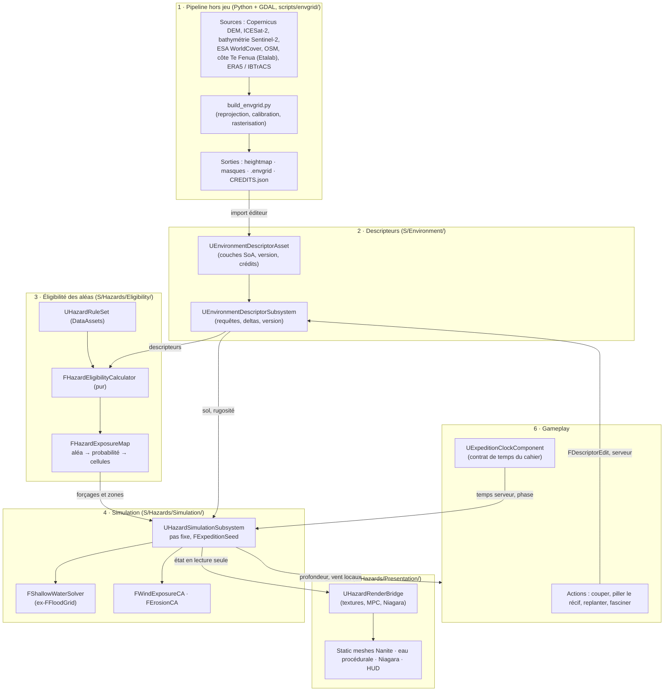

# 02 — Diagnostic et architecture cible : des aléas qui découlent du terrain

- **Date** : 2026-10-23 · **Entrée** : `docs/audit/01_REPO_MAP.md` (faits, abrégé « MAP »).
- **Statut** : **proposition**, rien n'est implémenté. Le contrat produit (`docs/CAHIER_DES_CHARGES.md`) prime toujours. Adopter cette direction demande un ADR et une révision du cahier (voir « Questions ouvertes »).
- **Convention** : 🔎 **Fait observé** (avec sa source) · 💡 **Recommandation**. `S/` = `monke_island/Source/monke_island/`.

---

## Partie A — Diagnostic

### A.1 Trois forces à conserver absolument

1. **Des cœurs de simulation purs, déterministes et testés.**
   - 🔎 `FFloodGrid` est un solveur d'eaux peu profondes sans UObject, « deterministic and testable » (`S/Flood/FloodGrid.h:4-10`). L'horloge d'expédition est faite de fonctions pures (`S/Expedition/Core/ExpeditionClock.cpp:22-116`). Le vent est seedé (`S/Storm/WindMath.h:25-29`), la météo est une fonction du temps serveur (`S/Storm/WeatherMath.h:16-26`). 107 specs couvrent ≈ 1 158 cas (MAP §6).
   - 💡 C'est exactement la forme que doit prendre la couche de simulation. On **déplace** ces cœurs, on ne les réécrit pas.
2. **Un pipeline de données réelles déjà scripté.**
   - 🔎 Côte officielle, atlas des récifs, découpe en 20 fragments séparés par la mer, placement de 43 057 cocotiers et de la végétation en DataTables lues par PCG (`scripts/map/build_terrain.py`, `place_*.py`, `docs/adr/ADR-004-fragments-tuamotu.md`).
   - 💡 C'est la base de la couche 1. Il lui manque une vraie altimétrie, des sources sous licence commerciale et une sortie « descripteurs ».
3. **Un serveur autoritaire qui réplique des entrées, pas des états.**
   - 🔎 Seuls l'horloge et le centre de grille sont répliqués ; chaque client simule la même eau localement (`S/Flood/FloodSimulationActor.cpp:163-169,401-424`). Toutes les valeurs passent par 58 classes `U*Rules` en DataAsset (MAP §5).
   - 💡 Ce modèle « mêmes entrées → même simulation » est ce qui rend une simulation de terrain jouable à 4 sans saturer la bande passante. Il faut le garder et le rendre vérifiable.

### A.2 Cinq problèmes structurels, du plus grave au moins grave

**1. Les aléas sont pilotés par le temps et par des scripts, jamais par le terrain.**
- 🔎 L'échéance du déluge vaut `départ + InitialFloodDelay + 120 s × zones` (`ExpeditionClock.cpp:22-25`). Elle est identique quelle que soit l'île.
- 🔎 La montée finale (650 cm en 60 s, exposant 1,6) ne dépend pas du terrain (`ExpeditionRules.h:47-55`).
- 🔎 La tempête se lève quand un joueur saisit un artefact (`S/Storm/WeatherDirector.cpp:194-231`).
- 🔎 Les chutes de noix de coco sont tirées au hasard sans seed (`S/Hazards/CoconutFallDirector.cpp:99-107`).
- 🔎 Le terrain n'intervient qu'en aval : il guide l'écoulement dans la grille d'inondation.
- **Conséquence** : sur les 20 fragments, le danger serait le même chronomètre. C'est le contraire de la logique visée.

**2. Le relief est inventé, et une partie des données d'entrée n'est pas diffusable.**
- 🔎 Les altitudes sont des constantes : terre de +0,5 à +3,7 m, lagon de −8 à −30 m (`scripts/map/build_terrain.py:46-59`). Aucune bathymétrie mesurée, aucun DEM (MAP §4).
- 🔎 Les hauts-fonds et la végétation dérivent de l'imagerie © Maxar, et les cocoteraies DAG sont limitées à la recherche et à l'éducation (MAP §7).
- **Conséquence** : une simulation physique juste sur un relief faux ne produit que du faux réalisme. Et la couche « occupation du sol », celle qui doit nourrir l'écologie défensive, est justement la plus fragile juridiquement.

**3. Aucune couche de descripteurs d'environnement : la sémantique est devinée à partir du rendu.**
- 🔎 Le sol de la simulation est relu par 16 000 lancers de rayons par image (`FloodSimulationActor.cpp:500`, `FloodRules.h:132-140`).
- 🔎 L'abri contre le vent est reconnu par mots-clés dans le nom des meshes (`"Minka"`, `"House"`, `"Pandanus"`, `S/Storm/WindRules.h:120-124`, `WindStormActor.cpp:184-188`).
- 🔎 Les palmiers sont reconnus par nom de mesh (`CoconutFallDirector.cpp:53-59`).
- **Conséquence** : le gameplay ne peut pas interroger « quelle est la pente, le sol, la couverture ici ». Renommer un asset casse un aléa. Une action du joueur (couper, planter) ne peut rien changer au risque.

**4. Un GameState d'expédition devenu « objet dieu », et des couplages circulaires.**
- 🔎 `ExpeditionGameState.h` est inclus par 20 fichiers. Son `.cpp` inclut Execution, Boats, Galleon, Player, Run et Islands (`ExpeditionGameState.cpp:3-25`). Il gère à la fois l'horloge, les phases, la mort par déluge (avec un `1.0e6f` en dur, `:648`), le bilan et l'exécution.
- 🔎 `Flood/` dépend de lui (`HazardClock.cpp:4`) ; la transition de jour dépend de l'UI (`DayTransitionSubsystem.cpp:3-15`). Cycles Weapons ↔ Player et Expedition ↔ Galleon. Aucun `APlayerState` (MAP §2.1).
- **Conséquence** : impossible d'insérer un moteur d'aléas entre le terrain et l'horloge sans toucher à la moitié du jeu.

**5. Ni seed d'expédition ni persistance : rien n'est rejouable, rien ne laisse de trace.**
- 🔎 Les graines viennent de `FMath::Rand()` (camps, butin, villages, forts), de `FPlatformTime::Cycles()` (arrivée de la barque) et de `UtcNow` (choix de l'île) (MAP §3.4).
- 🔎 Le terrain est fait de static meshes Nanite que rien ne déforme. `URunSaveGame` ne garde aucun état du monde (`S/Run/RunSaveGame.h:50-66`).
- 🔎 La CI ne compile pas le C++ et ne lance aucun test (`.github/workflows/verifications.yml`).
- **Conséquence** : impossible de rejouer une catastrophe pour la déboguer ou l'équilibrer. La « mémoire du terrain » n'a aucun support.

> Limite : la logique des Level Blueprints n'a pas pu être auditée, car les assets sont des pointeurs LFS (MAP, en-tête). Rien dans le C++ n'indique qu'un aléa y soit codé, mais ce n'est pas prouvé.

### A.3 Ce qui empêche aujourd'hui que les catastrophes découlent du terrain
| Verrou | Preuve | Levier |
|---|---|---|
| Pas d'altitude ni de bathymétrie réelles | `build_terrain.py:46-59` | Couche 1 : DEM et altimétrie laser, bathymétrie dérivée du satellite |
| Pas de grille de descripteurs que le jeu puisse interroger | traces et noms de meshes, §A.2-3 | Couche 2 |
| Déclencheurs en temps ou en script | `ExpeditionClock.cpp:22-25`, `WeatherDirector.cpp:194` | Couche 3 : éligibilité des aléas |
| Seeds dispersées | MAP §3.4 | `FExpeditionSeed` unique |
| Terrain non modifiable, aucun état sauvé | `FloodRules.h:15-16`, `RunSaveGame.h:50-66` | Deltas de descripteurs sauvés, rendu par textures |
| Occupation du sol non diffusable | MAP §7 | Sources ESA WorldCover / Sentinel-2 / OSM |
| GameState d'expédition central | §A.2-4 | Découpe en composants, dépendances vers le bas |

---

## Partie B — Architecture cible

### B.1 Vue d'ensemble

Règle de dépendance 💡 : chaque couche ne dépend que des couches de numéro inférieur, plus de `Core/` (seed, types). Le rendu et le gameplay **lisent** la simulation ; seul le serveur **écrit** dans les descripteurs. Cela suit `docs/conventions/architecture.md` (« une dépendance ne va que vers le bas ») et reste dans le module unique, comme l'exige la convention.

### B.2 Les couches, justifiées par l'existant

#### Couche 1 — Pipeline de données hors jeu
- 🔎 **Existant** : `scripts/map/` en numpy, Pillow et scipy, avec une projection écrite à la main (`build_terrain.py:67-72`). Sources Te Fenua et Maxar. Pas de GDAL.
- 💡 **Cible** : un nouveau dossier `scripts/envgrid/`, qui **réutilise** `find_fragments.py` et les `place_*.py` pour la découpe et le placement.
  - **Entrée** : une emprise WGS84 ou un identifiant de fragment `FRG_*`.
  - **Outils** : GDAL/rasterio et pyproj pour la reprojection en UTM 6S/7S. On arrête de coder la projection à la main.
  - **Sources**, avec une mise en garde : sur un atoll, le relief émergé (≈ 3 m) est **du même ordre que l'erreur verticale des DEM mondiaux**.

  | Besoin | Source proposée | Licence | Remarque |
  |---|---|---|---|
  | Altitude terre | Copernicus DEM GLO-30, calé sur les points ICESat-2 (ATL03/ATL08) | Copernicus : usage commercial permis avec attribution ; ICESat-2 : domaine public (NASA) | À vérifier : couverture Litto3D (SHOM/IGN) sur les Tuamotu. **IGN LiDAR HD ne couvre que la métropole** |
  | Bathymétrie | Dérivée de Sentinel-2 (rapport de bandes) jusqu'à −20 m, calée sur GEBCO au large | Copernicus ; GEBCO : libre avec attribution | Remplace les profils constants et la luminance Maxar |
  | Occupation du sol | ESA WorldCover 10 m + OSM (`natural=*`, `landuse=*`, `building`) | WorldCover : CC BY 4.0 ; OSM : **ODbL, attribution obligatoire** | Remplace les cocoteraies DAG et les masques Maxar |
  | Côte et toponymes | Te Fenua (déjà utilisé) | Etalab 2.0 | Garder ; corriger le README (cocoteraies) |
  | Climat | ERA5 (vent, houle), IBTrACS (trajectoires de cyclones) | Copernicus ; IBTrACS : domaine public (NOAA) | Fournit les forçages réalistes par région |
  | **Interdit** | Google Photorealistic 3D Tiles, imagerie Maxar | Licences incompatibles | MAP §7 : aucun usage de 3D Tiles trouvé |

  - **Sorties** :
    - `heightmap_16.png` (déjà produit) et les tuiles OBJ existantes ;
    - masques sable, végétation, récif et bâti ;
    - **`FRG_*.envgrid`** (binaire et en-tête JSON) ;
    - **`CREDITS.json`** généré, avec producteur, date, licence et URL par couche. Il comble l'absence de crédits relevée par l'audit 70.

#### Couche 2 — Descripteurs d'environnement
- 🔎 **Existant** : aucun. La sémantique est devinée par traces et par noms (A.2-3).
- 💡 **Cible** : une grille par fragment, rangée en tableaux de structures séparés (SoA), au pas de 4 m. FRG_01 mesure 3,9 × 5,0 km, ce qui donne ≈ 1,2 M cellules et ≈ 14 Mo.

  | Couche | Type | Unité | Origine |
  |---|---|---|---|
  | `Elevation` | int16 | cm (de −327 à +327 m) | DEM et bathymétrie |
  | `Slope` | uint8 | 0,25° | dérivée |
  | `DistToSea` | uint16 | m | dérivée (transformée de distance) |
  | `Soil` | uint8 (enum) | sable, platier, corail, terre, bâti, eau | WorldCover, OSM, atlas récif |
  | `VegCover` | uint8 | 0–255 = 0–100 % | WorldCover, Sentinel-2 (NDVI) |
  | `Roughness` | uint8 | Manning n × 1000 | table sol × végétation (DataAsset) |
  | `WindExposure[8]` | uint8 × 8 | 0–1 par secteur | horizon et obstacles calculés hors ligne |
  | `Flags` | uint8 | crête récifale, hoa, village, marae, interdit | côte, fragments, villages |

  - Le **`UEnvironmentDescriptorAsset`** est un `UPrimaryDataAsset` : il porte la grille, l'origine, le pas et le hash des crédits, et il est chargé avec la map par l'AssetManager. Le dépôt utilise déjà ce mécanisme pour `ExpeditionIsland` (`DefaultGame.ini:16-17`).
  - Le **`UEnvironmentDescriptorSubsystem`** (`UWorldSubsystem`) répond aux requêtes (`Sample`, `Query(rect)`), applique les `FDescriptorEdit` côté serveur et incrémente une `Version`.

#### Couche 3 — Moteur d'éligibilité des aléas
- 🔎 **Existant** : aucun. Chaque aléa a sa propre horloge ou son propre script.
- 💡 **Cible** :
  - **`UHazardRuleSet`** (DataAsset) : une liste de `UHazardRule`, une par aléa (`Hazard.Submersion`, `Hazard.Surge`, `Hazard.Wind`, `Hazard.Erosion`, `Hazard.CoconutFall`). Chaque règle combine des termes sur les descripteurs (seuils et courbes `UCurveFloat` sur l'altitude, la distance à la mer, la rugosité, l'exposition) et un forçage régional (houle et vent ERA5, cyclones IBTrACS).
  - **`FHazardEligibilityCalculator`** : une fonction pure, testable par Automation Spec, sur le modèle de `FRunContractCalculator`. Elle prend `(descripteurs, règles, FExpeditionSeed)` et rend une `FHazardExposureMap`.
  - **Interdiction** : aucun aléa codé dans un Blueprint ou une Level Blueprint. Les classes de règles sont `EditInlineNew` et `Abstract` côté C++ ; un Blueprint ne fait que choisir et régler.
  - **Compatibilité avec le cahier** : la **durée** de l'expédition (déluge à 9 min, cahier v1.4) reste la loi du contrat. Ce que le terrain décide, c'est **où, dans quel ordre et avec quelle force** la mer arrive, et **quels** aléas secondaires sont possibles sur cette île. Changer le principe du chronomètre demande l'accord du propriétaire (voir « Questions ouvertes »).

#### Couche 4 — Simulation
- 🔎 **Existant** : `FFloodGrid`, avec deux passes `ParallelFor` sur **CPU** ; grille de 320 × 320 cellules de 8 m ; pas de 0,05 s (MAP §3.2). Le vent est une fonction du temps.
- 💡 **Cible** : un `UHazardSimulationSubsystem` (`UTickableWorldSubsystem`) à pas fixe, qui possède des solveurs sans UObject :
  - `FShallowWaterSolver` : c'est `FFloodGrid` **déplacé**, auquel on ajoute un frottement par cellule (`Roughness`) et un sol lu dans les descripteurs, ce qui supprime les lancers de rayons ;
  - `FWindExposureCA` : un automate cellulaire qui propage le vent et l'embrun d'après `WindExposure` et la végétation ;
  - `FErosionCA` : l'érosion et l'ensablement, sur les cellules de sable mouillées au-delà d'un seuil (phase 2, après la tranche verticale).
- 💡 **Faut-il passer au GPU ? Pas pour la tranche.** C'est un écart assumé avec la piste « shallow water sur GPU » de la mission :
  - 🔎 Le modèle réseau du dépôt repose sur **la même simulation sur chaque machine** (A.1-3). Un solveur en compute shader n'est pas déterministe d'un GPU à l'autre (ordre des opérations flottantes, pilotes). Il faudrait alors répliquer l'état complet, soit environ 100 k cellules à 10 Hz : trop pour un listen server à 4.
  - Ordre de grandeur, **estimé et non mesuré** : 512² cellules × 20 pas/s ≈ 5 M mises à jour par seconde, soit environ 0,4 à 0,8 ms par pas sur 6 cœurs.
  - **Seuil de bascule** : le GPU (RDG et compute) ne se justifie qu'au-delà de 1024² cellules, ou pour un **raffinement purement visuel** (écume, ondulations), qui ne fait pas foi pour le gameplay.
- 💡 **Déterminisme et rejeu** :
  - une seule seed, `FExpeditionSeed` (`S/Core/`), dont dérivent des sous-flux nommés (`Derive("Hazard.Wind")`) ;
  - elle remplace `FMath::Rand()`, `UtcNow` et `Cycles()` (MAP §3.4) ;
  - les entrées sont journalisées (`FDescriptorEdit` horodatés au pas serveur) : une expédition se rejoue à partir de la seed et du journal.
- 💡 **Grille de simulation séparée du rendu** : elle l'est déjà, puisque `FFloodGrid` a ses propres cellules. On garde ce principe, et on fait du pas de simulation un multiple du pas des descripteurs (8 m = 2 × 4 m).

#### Couche 5 — Rendu
- 🔎 **Existant** : `AFloodSimulationActor` simule **et** construit les meshes procéduraux (`FloodSimulationActor.cpp:237-361`). Le terrain est en static meshes Nanite. Il n'y a ni plugin Water ni Landscape.
- 💡 **Cible** : un `UHazardRenderBridge`, qui lit l'état de la simulation sans jamais le calculer.
  - Il écrit une texture R16F de profondeur d'eau et de vent (5 Hz) et des paramètres de MPC ; les matériaux, l'eau procédurale existante et Niagara (via un Data Interface sur la texture) la lisent.
  - `AFloodSimulationActor` devient purement visuel (les blocs procéduraux sont conservés).
  - **On ne passe pas à Landscape pour la tranche** : les tuiles Nanite et le pipeline OBJ fonctionnent. Les modifications visibles du sol (ensablement, récif abîmé) passent par la texture de descripteurs dans le matériau du terrain (décals ou Runtime Virtual Texture), sans changer la collision.
  - **Plugin Water** : il n'apporte rien ici (MAP §1.3). On ne l'ajoute pas.

#### Couche 6 — Gameplay
- 🔎 **Existant** : les actions des joueurs (piller, porter, combattre) n'ont aucun effet sur l'environnement.
- 💡 **Cible** : toute action « environnementale » produit un `FDescriptorEdit`, validé par le serveur (distance, outil, cooldown, comme l'interaction du cahier §4). Cela change les descripteurs, donc la simulation, donc l'exposition. L'horloge sort du GameState et devient un `UExpeditionClockComponent` attaché au GameState, qui conserve `ExpeditionClock` (fonctions pures).

### B.3 Classes et modules

| Action | Élément | Chemin cible | Pourquoi |
|---|---|---|---|
| **Créer** | Pipeline des descripteurs, registre de crédits | `scripts/envgrid/build_envgrid.py`, `scripts/envgrid/sources/*.py`, `scripts/envgrid/credits.py` | Couche 1, licences |
| Créer | `UEnvironmentDescriptorAsset`, `FEnvDescriptorGrid`, `FDescriptorEdit` | `S/Environment/EnvironmentDescriptorAsset.h`, `S/Environment/EnvironmentTypes.h` | Couche 2 |
| Créer | `UEnvironmentDescriptorSubsystem` | `S/Environment/EnvironmentDescriptorSubsystem.h` | Requêtes, deltas, version |
| Créer | `UHazardRuleSet`, `UHazardRule` (abstraite), `FHazardEligibilityCalculator`, `FHazardExposureMap` | `S/Hazards/Eligibility/` | Couche 3 |
| Créer | `UHazardSimulationSubsystem`, `IHazardSolver`, `FWindExposureCA` (puis `FErosionCA`) | `S/Hazards/Simulation/` | Couche 4 |
| Créer | `UHazardRenderBridge` | `S/Hazards/Presentation/` | Couche 5 |
| Créer | `UHazardSyncComponent` (somme de contrôle toutes les 5 s, instantané correctif) | `S/Hazards/Net/` | Prouver le déterminisme en réseau |
| Créer | `FExpeditionSeed` | `S/Core/ExpeditionSeed.h` | Une seule seed d'expédition |
| **Garder** | `ExpeditionClock` (pur), `WindMath`, `WeatherMath`, `WaveMath`, `UIslandWaterSubsystem` (fournisseur de surface), `FRunContractCalculator`, `find_fragments.py`, `place_*.py` | inchangés | Déjà purs, testés ou utiles |
| **Refactorer** | `FFloodGrid` → `FShallowWaterSolver` (+ rugosité, sol venu des descripteurs) | `S/Hazards/Simulation/ShallowWaterSolver.h` | Supprime 16 000 rayons par image |
| Refactorer | `AFloodSimulationActor` : rendu seul | `S/Hazards/Presentation/` | Séparer simulation et rendu |
| Refactorer | `HazardClock`, `FloodSeaRiseSubsystem` : lisent `UHazardSimulationSubsystem`, plus le GameState | `S/Flood/` puis `S/Hazards/` | Casse Flood → Expedition |
| Refactorer | Abri au vent par `WindExposure` et tags, pas par nom de mesh | `S/Storm/WindStormActor.cpp:151-190` | A.2-3 |
| Refactorer | `CoconutFallDirector` : palmiers lus dans les descripteurs ou les attributs PCG, seed dérivée | `S/Hazards/CoconutFallDirector.cpp` | A.2-1, A.2-5 |
| Refactorer | `WeatherDirector` : déclenché par l'éligibilité (forçage), l'artefact devenant un modificateur | `S/Storm/WeatherDirector.cpp:194-231` | A.2-1 |
| Refactorer | `AExpeditionGameState` → `UExpeditionClockComponent` et `UDelugeResolutionComponent` ; ajout d'un `APlayerState` | `S/Expedition/Core/` | A.2-4 ; supprime le `1.0e6f` codé en dur |
| Refactorer | `build_terrain.py` : altitudes calibrées au lieu des profils constants | `scripts/map/build_terrain.py:46-59` | A.2-2 |
| Refactorer | `UDayTransitionSubsystem` : ne plus inclure l'UI | `S/UI/…` | Dépendance vers le haut |
| **Supprimer** | Lancers de rayons de la grille (`TracesPerFrame`, `TraceTopCm`…) | `S/Flood/FloodRules.h:132-140` | Remplacés par les descripteurs |
| Supprimer | `Variant_Horror/`, `Variant_Shooter/`, `Lvl_Horror`, `Lvl_Shooter`, `Lvl_FirstPerson` (après avoir détaché `BP_Islander` d'`IMC_Horror` et du contrôleur du template) | `S/Variant_*`, `Content/Variant_*` | Code mort référencé |
| Supprimer | Masques dérivés de Maxar, cocoteraies DAG des builds | `scripts/map/build_terrain.py:238-284`, `place_palms.py` | Licences (MAP §7) |
| Supprimer | `FRunCalculator` si l'ADR-005 est abandonnée ; `*_PreT184` ; `fragment_candidates.py` | — | Code mort |

### B.4 Contrats entre couches

| De → vers | Structure | Contenu | Fréquence |
|---|---|---|---|
| 1 → 2 | `FRG_*.envgrid` + `CREDITS.json` | en-tête (origine UTM, pas, dimensions, version du schéma, hash des sources), couches SoA (B.2-2) | Hors ligne, à chaque reconstruction |
| 2 → 3 | `const FEnvDescriptorGrid&` + `int32 Version` | lecture seule | Au début de l'expédition, puis à chaque nouvelle `Version` (au plus 1 Hz, regroupée) |
| 3 → 4 | `FHazardExposureMap` | par aléa : `FGameplayTag Hazard`, `float Probability`, `float Intensity`, masque de cellules exposées, forçage (`SurgeCm(t)`, `WindDir`, `WindSpeed(t)`) | Au début, puis à chaque changement de version |
| 2 → 4 | sol, rugosité, drapeaux | lecture seule, copie dans les tableaux du solveur | Au début, puis par delta |
| Horloge → 4 | `FExpeditionClockState` répliqué (existant) | temps serveur, phase, échéance | Réplication existante ; la simulation compte ses pas depuis l'horloge (comme `FloodSimulationActor.cpp:549-558`) |
| 6 → 2 | `FDescriptorEdit` | `FIntRect Cells`, `EEnvLayer Layer`, `EEditOp Op`, `int16 Value`, `FGameplayTag Cause`, `int32 ServerStep` | Sur événement, côté serveur ; répliqué en journal (`FFastArraySerializer`) |
| 4 → 5 | `FHazardRenderView` | textures R16F (profondeur, vent), plage de valeurs, `StepIndex` | 5 Hz (le rendu interpole) |
| 4 → 6 | `SampleWater(FVector)`, `SampleWind(FVector)` | profondeur, vitesse, vent local | À la demande (nage, noyade, IA) |
| 4 ↔ réseau | `FHazardChecksum` | `StepIndex`, CRC32 de l'état | Toutes les 5 s ; instantané compressé si écart |

### B.5 Budget de performance
Le budget de référence vient de `docs/conventions/performance.md:16-30` : 60 FPS, image ≤ 16,6 ms, thread de jeu ≤ 8 ms, eau et translucides ≤ 1,5 ms GPU.

| Poste | Cible | Remarque |
|---|---|---|
| Grille de descripteurs | 4 m, ≈ 1,2 M cellules par fragment, ≤ 16 Mo | Chargée une fois |
| Grille de simulation d'eau | **512 × 512 à 6 m** (≈ 3 km, couvre tout fragment jouable de 2,3 km maximum) ; repli 320² à 8 m (existant) | ≈ 262 k cellules, ≈ 5 Mo |
| Pas de simulation | 20 pas/s (0,05 s, existant), au plus 4 pas de rattrapage par image | Fixe, indépendant de l'image |
| Automate de vent | 64 × 64 cellules de 48 m, 2 pas/s | Coût négligeable |
| Coût CPU de la simulation | **≤ 1,0 ms en moyenne, ≤ 2,0 ms en pic** sur le thread de jeu, sur les workers | À mesurer avec `stat` et Unreal Insights à la semaine 2 |
| Pont de rendu | ≤ 0,3 ms (copie de texture à 5 Hz) ; maillage procédural de l'eau ≤ 1 ms (budget existant) | |
| Mémoire totale des aléas | ≤ 40 Mo | |
| Réseau | journal des deltas ≤ 1 ko/s ; somme de contrôle 8 o toutes les 5 s | Jamais l'état complet en régime normal |
| Cible d'image | 60 FPS (1 % bas ≥ 45 FPS) en 1080p avec 4 joueurs pendant la submersion | Mesure : `scripts/ue.ps1 profile` + `perf_summary.py` |

### B.6 Évaluation des mécaniques uniques
Échelle de **1 à 5, plus c'est haut, mieux c'est** : Faisabilité 5 = presque déjà dans le dépôt ; Coût 5 = très bon marché ; Originalité 5 = aucun équivalent chez Cities: Skylines, Timberborn ou Frostpunk.

| Piste | Faisab. | Coût | Origin. | Justification |
|---|---|---|---|---|
| **Le terrain est l'adversaire** (carte des risques lisible, anticipation) | 4 | 4 | 2 | 🔎 La grille d'eau suit déjà le relief. Mais Cities: Skylines (eau simulée, tsunamis) et Timberborn (eau qui suit le terrain) le font déjà. C'est un **socle nécessaire**, pas un argument de vente |
| **Écologie défensive** (mangroves, cocotiers, récif) | 3 | 3 | 3 | Il suffit d'ajouter une rugosité par cellule à `FFloodGrid`. Timberborn a les digues et les barrages, mais pas la protection par la végétation et le récif. À noter : **la cocoteraie ne protège pas d'une submersion** ; le récif et la végétation de rivage (*Pemphis*, *Scaevola*) jouent ce rôle. Il faut rester crédible |
| **Mémoire du terrain** (érosion et ensablement durables) | 2 | 2 | 4 | 🔎 Les static meshes Nanite ne se déforment pas et rien n'est sauvé (A.2-5). Faisable en version « texture + descripteurs » ; une vraie topographie modifiable demanderait Landscape ou des Dynamic Mesh, donc beaucoup de coût |
| **Savoirs et signes naturels** (houle, oiseaux, ciel) | 4 | 3 | 4 | Les signes peuvent se calculer à partir de la simulation (période de houle, eau dans les hoa, oiseaux qui partent). Original dans le genre. **Contrainte** : la bible interdit de reprendre des « rites ou légendes réels » (`docs/narrative/BIBLE.md`, « À éviter »). Il faut donc des phénomènes naturels, pas un savoir culturel inventé |
| **Roguelite sur îles réelles** | 2 | 2 | 3 | 🔎 Un seul fragment est construit sur 20, le pipeline couvre un seul atoll, et les sources actuelles ne sont pas diffusables. L'aléa de chaque île serait réel, mais le joueur ne voit pas la différence entre « réel » et « plausible » |
| 💡 **Le pillage abîme le rempart** (issue du code) | 4 | 4 | **5** | Le cœur du jeu est déjà le pillage (`Items/ValuableComponent`, `Run/`, cahier §5). Si couper la cocoteraie de rivage, arracher le corail du platier ou vider le marae change la rugosité ou l'altitude des cellules, **la cupidité fait monter la mer plus vite, là où l'équipage se trouve**. Aucun des trois jeux cités ne lie l'extraction au risque. Cela rejoint aussi l'USP proposée par l'audit 81 (« la cupidité se pèse, se noie et se facture ») et la satire de la Couronne. L'inverse, réparer pour gagner du temps, **est** l'écologie défensive |
| 💡 **Les hoa vivants** (issue du code) | 4 | 4 | 3 | 🔎 La barque est physique (`S/Boats/`) et les fragments sont découpés par les hoa (ADR-004). Avec la grille, la montée des eaux ouvre et ferme des chenaux pour la barque : les routes d'évacuation changent selon le relief réel |

💡 **Choix pour la tranche verticale : « Le pillage abîme le rempart »**, avec la réparation comme contrepartie (écologie défensive minimale). C'est la seule piste à 5 en originalité, elle s'appuie sur la boucle existante, et elle rend visible la logique « aléa = terrain » sans demander de déformer la topographie.

### B.7 Tranche verticale de 6 semaines
**Périmètre** : 1 atoll (fragment `FRG_Raraka_01`, map `L_Frag_Raraka_01` existante), 1 aléa (la submersion), 1 mécanique (le pillage abîme le rempart). Le travail se fait sur une branche dédiée, après l'ADR. Chaque critère précise le niveau de preuve attendu par le cahier (§2, §13).

| Semaine | Livrable | Critère de fin vérifiable |
|---|---|---|
| **S1. Données** | `scripts/envgrid/` produit `FRG_Raraka_01.envgrid` et `CREDITS.json` à partir de Copernicus DEM, ICESat-2, Sentinel-2, WorldCover, OSM et de la côte Te Fenua. Aucune entrée Maxar ni DAG | Test Python : la terre de l'envgrid recouvre la côte Te Fenua à ≥ 95 % ; altitude médiane des motu entre 1 et 4 m ; chaque couche a une ligne de licence. Niveau : `testé hors moteur` |
| **S2. Descripteurs dans le jeu** | `UEnvironmentDescriptorAsset`, son sous-système, son import éditeur ; `FFloodGrid` lit le sol dans les descripteurs, lancers de rayons supprimés ; `FExpeditionSeed` | Spec `monke_island.Environment.*` : `Sample` exact sur 20 cellules de référence ; spec `monke_island.Hazards.Determinism` : deux simulations de 600 s avec la même seed donnent le même CRC. Niveau : `compilé` + `testé éditeur` |
| **S3. Éligibilité** | `UHazardRuleSet` et `DA_HazardRules_Atoll` ; exposition à la submersion (altitude, distance à la mer, rugosité) ; forçage de surcote par seed ; superposition de débogage `monke.HazardOverlay` | Spec : la même règle sur deux fragments donne deux ordres d'inondation différents. En PIE, l'ordre d'arrivée de l'eau dans les 3 villages correspond à la carte d'exposition. Niveau : `testé éditeur` |
| **S4. Mécanique** | `FDescriptorEdit` serveur : abattre la végétation de rivage et prélever le corail du platier abaissent `Roughness` et `Elevation` ; replanter ou poser une fascine les relèvent ; coût en temps et en emplacements | Spec : déboiser 200 cellules de rivage avance l'arrivée de l'eau au village voisin d'au moins 20 s (valeur en DataAsset), et la restauration la retarde. En PIE solo, l'effet est visible. Niveau : `testé éditeur` |
| **S5. Lisibilité et rendu** | `UHazardRenderBridge` (texture vers le matériau du terrain et l'eau) ; carte des risques au galion, présentée comme le « cadastre des risques » du Bureau ; deux signes naturels (l'eau monte d'abord dans les hoa, les oiseaux quittent les motu exposés) | Playtest à 3 personnes : au moins 2 sur 3 prédisent la première zone inondée à partir de la carte, et au moins 2 sur 3 relient leur pillage à la montée plus rapide. Niveau : `testé éditeur` + rapport de playtest |
| **S6. Réseau, performance, preuve** | `UHazardSyncComponent` ; profil CSV pendant la submersion ; package Development | Hôte et client **sur deux PC** : 0 écart de somme de contrôle sur 3 expéditions ; CSV : simulation ≤ 1 ms en moyenne et 60 FPS en médiane. Niveau : `testé build` + `testé multi-machines` |

### B.8 Top 5 des risques
| # | Risque | Type | Mitigation |
|---|---|---|---|
| 1 | **Le relief d'un atoll est sous le bruit des DEM mondiaux** (≈ 3 m de relief pour 2 à 4 m d'erreur verticale) : la carte des risques devient arbitraire | Technique et données | Caler sur ICESat-2 ; vérifier Litto3D ; lisser et contraindre par la côte et les classes de récif. Afficher « plausible, d'après des données réelles », jamais « prévision ». Spec de plausibilité en S1 |
| 2 | **Licences** : dérivés Maxar, cocoteraies DAG, raster IRD sans licence ; obligations ODbL et Etalab (attribution, date) | Juridique | Sources de remplacement dès S1 ; `CREDITS.json` affiché en jeu ; purge des dérivés Maxar et DAG du package ; aucune tuile Google ; avis d'un juriste avant toute diffusion commerciale |
| 3 | **Le réalisme n'est ni lisible ni amusant** : les joueurs ne font pas la différence avec un chronomètre | Gameplay | La mécanique « pillage → mer » donne une cause visible ; carte au galion ; playtest au critère chiffré en S5 ; tout est réglable en DataAsset |
| 4 | **Désynchronisation entre machines** : flottants, ordre des deltas, rattrapage de pas | Technique et réseau | Pas fixe, deltas horodatés au pas serveur, sommes de contrôle et instantané correctif ; CPU plutôt que GPU pour l'état qui fait foi ; serveur autoritaire pour les dégâts (déjà le cas) |
| 5 | **Conflit avec le contrat produit et dispersion** : le cahier v1.4 fixe un jeu d'extraction à chronomètre ; 147 tickets en `review` et aucun lot validé (`docs/production/recette-2026-10-11.md`) | Projet | ADR et révision du cahier avant de coder ; la tranche réutilise la boucle existante sans la remplacer ; branche séparée ; ne pas commencer avant que le noyau L1–L4 soit recetté, sauf décision explicite du propriétaire |

---

## Questions ouvertes
1. **Quel est le jeu ?** Le brief parle d'un « jeu de survie face aux catastrophes ». Le dépôt et son cahier décrivent un **coop d'extraction satirique** où la submersion est un chronomètre. Faut-il greffer la logique « aléas = terrain » sur ce jeu (c'est l'option de ce document), ou faut-il un pivot vers la survie, ce qui demanderait un nouveau cahier ?
2. **Le chronomètre de 10 minutes reste-t-il la loi ?** Si le terrain décide aussi *quand* la mer arrive, la durée d'une expédition varie d'une île à l'autre, et le cahier v1.4 doit changer.
3. **« Thème écologique de TAPAO »** : rien dans le dépôt ne le formule. La bible définit *tapao* comme « signe, marque », et le ton est la satire coloniale. Faut-il assumer un propos écologique, ou le garder implicite dans la mécanique ?
4. **Lieu réel nommé ou non ?** Une « île réelle » comme argument (roguelite, « ton atoll ») s'oppose à ADR-004 et à la bible, qui excluent Motutapu et ne nomment jamais Raraka.
5. **Cyclone** : faut-il un vrai cyclone (trajectoire IBTrACS, surcote, vent tournant) dans la V1, ou la tempête actuelle suffit-elle ?
6. **Sources** : Litto3D couvre-t-il les Tuamotu ? Une demande écrite à la DAF ou à Te Fenua pour les dérivés est-elle envisagée ?
7. **Blueprints** : un clone avec les objets LFS est nécessaire pour vérifier qu'aucun aléa ou état de partie n'est codé dans une Level Blueprint (`L_Frag_Raraka_01`, `LI_ExpeditionCore`).
8. **Priorité** : faut-il lancer cette tranche avant ou après la recette du noyau L1–L4 (ordre des lots imposé par `CLAUDE.md`) ?
